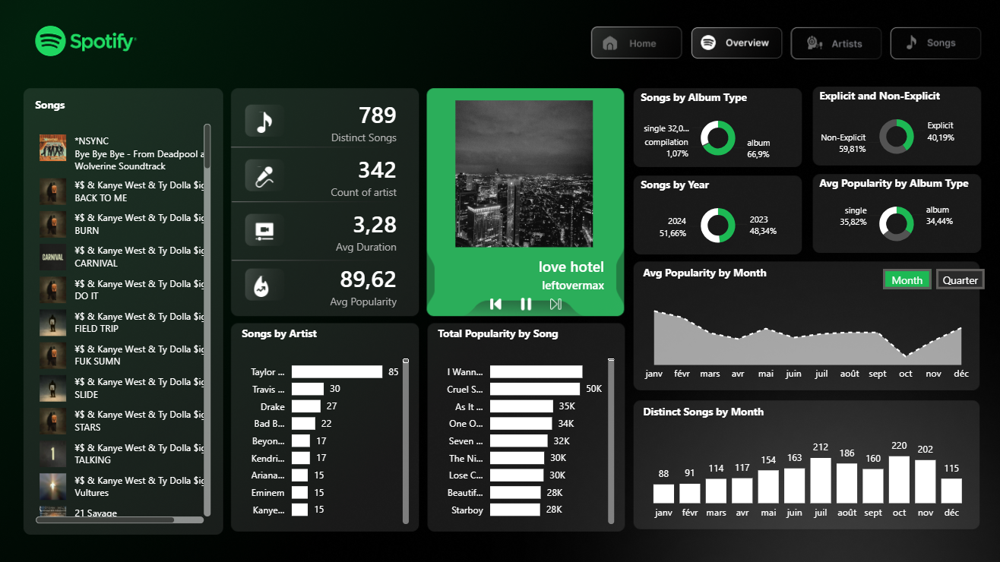
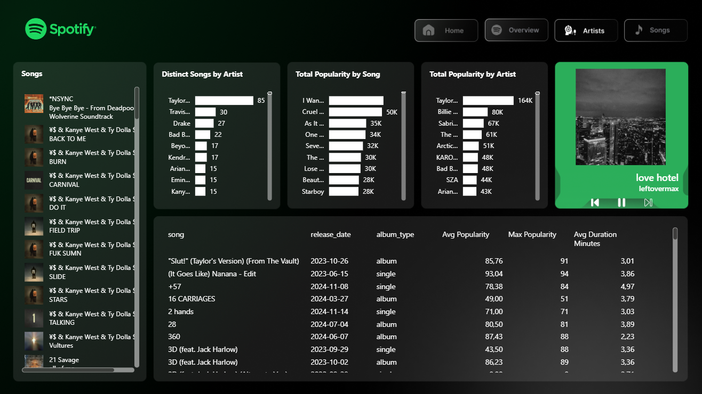
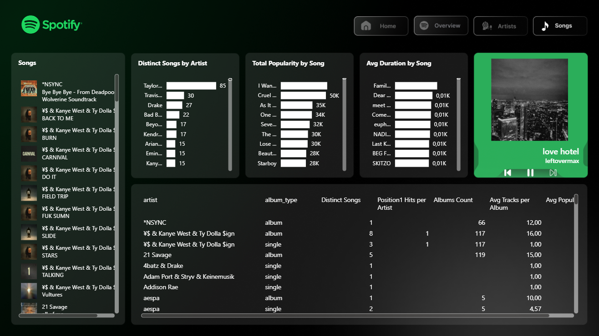

# Spotify Top 50 : dashboard Power BI

Un tableau de bord en 4 pages sur le classement quotidien Spotify Top 50 monde (27 800 lignes, mai 2023 à novembre 2024) : lecteur de titres, indicateurs, répartitions et tendances.

## Ce que contient le dashboard

| Page | Contenu |
|---|---|
| **Home** | page d'accueil avec navigation |
| **Overview** | liste des titres avec pochettes, 4 indicateurs (titres distincts, artistes, durée moyenne, popularité moyenne), lecteur qui affiche la pochette du titre, 4 anneaux (type d'album, explicit, année, popularité par type), courbe de popularité avec bascule **Month / Quarter**, titres par mois |
| **Artists** | titres par artiste, popularité totale par titre et par artiste, lecteur, tableau des titres (date de sortie, type, popularité, durée) |
| **Songs** | même structure, avec un tableau par artiste (titres distincts, albums, pistes par album, popularité) |

## Techniques

- **Modèle** : une table `Top-50-world` importée d'un CSV, des colonnes calculées (année, mois, trimestre, libellé explicit) et **36 mesures DAX** rangées par dossiers.
- **Lecteur** : mesures `Now Song`, `Now Artist`, `Now Cover` (catégorie d'image) qui suivent la sélection dans la liste ; sans sélection, le titre le plus populaire s'affiche.
- **Bascule Month / Quarter** : deux graphiques superposés et deux **signets**, un par vue.
- **Navigation** : boutons de page invisibles posés sur les onglets dessinés dans le fond.
- **Rapport généré par code** : un script écrit toutes les pages et tous les visuels au format PBIR. Modifier une mise en page revient à modifier un script.

## Sources

Ce dépôt est une **vitrine** : il présente le projet et ses résultats. Les sources (projet Power BI, requêtes, scripts, notebook, données) ne sont pas publiées. Pour en discuter, me contacter via mon profil GitHub.

## Crédits

Le cahier des charges et le design (fonds, icônes) viennent d'un tutoriel Power BI sur Spotify. J'ai construit le modèle, les mesures, le lecteur, les signets et le générateur de rapport. Le projet a été construit avec l'aide de Claude.
